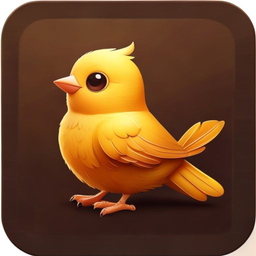

<div align="center">



# Pekko

**一席声景，契合你当下的状态。**

打字的声音，可以是一颗轴，也可以是一种心境。它待在 macOS 的菜单栏里。

<p>
  <a href="LICENSE"></a>
  <a href="https://github.com/UltiSpike/pekko/releases"></a>
  
</p>

</div>

---

按键落下，是一段真实的轴体录音，从左到右贴着键位。Black 与 Holy Panda 各有自己的身体、弹簧与尾音。坐得久了，音量自己退半步，声音还在，只是不再往前挤。五种心境：厚实的 Thock、沉进噪声的专注与写作、轴体本来的样子，以及一阵街机冲刺。

**[下载 macOS 版](https://github.com/UltiSpike/pekko/releases)** · macOS 11 及以上

它需要辅助功能权限，才能在别的应用处于前台时听到按键。Pekko 只读键码（按下或抬起），不读你输入的字符，也不访问网络。[隐私声明](PRIVACY.md)

从源码运行（Node 18+）：

```bash
git clone https://github.com/UltiSpike/pekko.git && cd pekko && npm i && npm run dev
```

`←` `→` 切换轴体 · `[` `]` 切换 Mode · `T` 调音抽屉 · `⇧⌘K` 静音 · `⌥⌘K` 唤起 / 隐藏窗口

&nbsp;

---

&nbsp;

## 五种 Mode

| Mode | 底层声 | 性格 |
|------|--------|------|
| **Thock** · 默认 | 无 | 低频厚、暖空间、每一击都有重量感 |
| Deep Focus | 棕噪声, -38 dB | 按键压暗，声音隐入工作背后 |
| Cozy Writing | 粉噪声, -40 dB | 温暖粉噪 + 柔和按键，陪伴长时间写作 |
| Classic Mech | 无 | 全频真实机械键盘还原 |
| Rush | 无 | 街机连击叠在按键声上，带 HUD |

&nbsp;

---

&nbsp;

## 声学引擎

按 Mode 变化：低频搁架、湿声比例、空气低通、逐键抖动。始终不变：24 声部池、104 键声像映射、端到端延迟 < 10 ms。

<details>
<summary>信号链与参数</summary>

&nbsp;

```
                       ┌──── 干声 (82-88%) ────┐
  主增益 ──────────────┤                       ├── 低频搁架 ── 中频凹陷 ── 高频搁架 ── 空气LPF ── 压缩器 ──▶ 输出
                       └── 12ms 延迟 ── 桌面LPF ── 湿声 (12-18%) ──┘

  底层声 (棕 | 粉) ───────────────────────────────────────────────▶ 输出 （绕过压缩器）
```

| 节点 | 默认 (Classic) | Mode 范围 |
|------|----------------|-----------|
| 低频搁架 @ 180 Hz | +2.5 dB | +2.5 到 +6 dB |
| 湿声比例 | 12% | 12–18% |
| 空气低通 | 13 kHz, Q 0.5 | 6.5–13 kHz |
| 高频搁架 @ 9 kHz | +0.5 dB | -1 到 +0.5 dB |
| 音高抖动 (±) | 2.5% | 0.3–2.5% |
| 底层声 | — | 棕 / 粉 / 无, -38 到 -40 dB |
| 中频凹陷 | -3 dB @ 3.8 kHz, Q 1.5 | 固定 |
| 压缩器 | -18 dB, 2.5:1, 35 ms attack | 固定 |
| 调度偏移 | 2 ms | 固定 |

</details>

&nbsp;

---

&nbsp;

## 十三种轴体

| 类型 | 轴体 |
|------|------|
| **线性 (Linear)** | Cherry MX Black (HQ) · Red (HQ) · NK Cream (HQ) · Gateron Red Ink · Black Ink |
| **段落 (Tactile)** | Cherry MX Brown (HQ) · Topre Purple (HQ) · Holy Panda · Topre |
| **青轴 (Clicky)** | Cherry MX Blue (HQ) · Blue · Kailh Box Navy · Buckling Spring |

<sub>*(HQ)* = 逐键高保真录音（sprite 或 multi-file 格式）。其他为 5 变体 kbsim 采样包。</sub>

统一的仪器面板视觉，自动跟随系统 light / dark。详见 [docs/design/CHASSIS.md](docs/design/CHASSIS.md)。

&nbsp;

---

&nbsp;

<details>
<summary>架构</summary>

&nbsp;

```
  Main (Electron)                            Renderer (React)
 ┌────────────────────────┐              ┌───────────────────────────┐
 │  uiohook-napi ──────── MessagePort ──▶  AudioEngine              │
 │  (全局键盘钩子)         │              │  (24 声部池, StereoPanner) │
 │  IPC Handlers ◄────── invoke ────────▶  React UI                 │
 │  Tray · Store (JSON)   │              │  (NES.css + 毛玻璃)       │
 └────────────────────────┘              └───────────────────────────┘
```

```
src/
├── main/
│   ├── index.ts             # 生命周期、全局快捷键
│   ├── keyboard.ts          # uiohook → MessagePort
│   ├── ipc-handlers.ts      # 音效包加载（白名单 + 路径安全）
│   ├── preload.ts           # contextBridge (7 methods)
│   ├── store.ts             # JSON 持久化
│   └── tray.ts              # 托盘菜单
├── renderer/
│   ├── audio/AudioEngine.ts # 心理声学引擎
│   ├── components/          # UI 组件
│   └── hooks/               # useAudioEngine, useProfiles
└── shared/
    ├── types.ts
    ├── modes.ts             # 5 个 Mode preset（bed + StyleLevel 组合）
    └── key-positions.ts     # 104 键声像映射
```

</details>

<details>
<summary>安全</summary>

&nbsp;

完全离线。代码库中没有 `fetch`、`http` 或任何出站调用。

`contextIsolation: true` · `nodeIntegration: false` · `contextBridge` 暴露 7 个只读方法 · Profile ID 白名单校验 + 路径遍历拦截。

</details>

<details>
<summary>开发命令</summary>

&nbsp;

| 命令 | 说明 |
|------|------|
| `npm run dev` | Vite + Electron 开发模式 |
| `npm run dev:debug` | 同上 + DevTools |
| `npm run build` | 构建 |
| `npm run package` | 打包 .dmg + .zip (arm64 & x64) |

</details>

&nbsp;

---

&nbsp;

[贡献](CONTRIBUTING.md) · [Mechvibes](https://mechvibes.com) · [uiohook-napi](https://github.com/nickolay/uiohook-napi) · [NES.css](https://nostalgic-css.github.io/NES.css/)

[Apache 2.0](LICENSE) — 音效包遵循各自许可（[NOTICE](NOTICE)）
